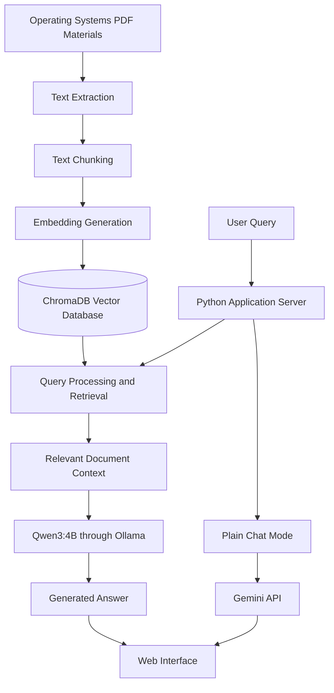

# OSNOVA — AI-Powered Operating Systems Learning Assistant

**An intelligent, document-grounded learning assistant for Operating Systems using Retrieval-Augmented Generation (RAG).**

[](https://www.python.org/)
[](https://ollama.com/)
[](https://arxiv.org/abs/2005.11401)
[](https://www.trychroma.com/)
[](https://github.com/HIMANSHI-hims/OSNOVA)

OSNOVA is an AI-powered Operating Systems learning assistant designed to help students understand concepts through answers grounded in their study materials. It combines document processing, vector-based retrieval, and language-model generation to provide an interactive learning experience.

The primary RAG workflow uses **Qwen3:4B locally through Ollama**, while **Gemini 3.5 Flash Lite** powers the separate Plain Chat mode through the Gemini API.

**GitHub Repository:** https://github.com/HIMANSHI-hims/OSNOVA

---

## Table of Contents

- [Overview](#overview)
- [Objectives](#objectives)
- [Key Features](#key-features)
- [Technology Stack](#technology-stack)
- [System Architecture](#system-architecture)
- [How RAG Works in OSNOVA](#how-rag-works-in-osnova)
- [Interaction Modes](#interaction-modes)
- [Project Structure](#project-structure)
- [Prerequisites](#prerequisites)
- [Installation and Setup](#installation-and-setup)
- [Running OSNOVA](#running-osnova)
- [Adding Study Materials](#adding-study-materials)
- [Testing the System](#testing-the-system)
- [Findings and Limitations](#findings-and-limitations)
- [Future Enhancements](#future-enhancements)
- [Team Details](#team-details)
- [References](#references)

---

## Overview

Students often need to search through lengthy Operating Systems notes to find explanations, understand technical concepts, and prepare for laboratory examinations and vivas. General-purpose chatbots can provide useful explanations, but their responses may not align with the specific material prescribed for a course.

OSNOVA addresses this problem by combining Retrieval-Augmented Generation with an interactive web interface.

Instead of relying entirely on the language model's internal knowledge, the RAG workflow retrieves relevant passages from ingested study materials and supplies them as context for answer generation.

The system also offers a separate general-purpose chat mode and specialized learning modes for revision and practice.

## Objectives

- Provide an interactive assistant for learning Operating Systems concepts.
- Process and index study materials for efficient retrieval.
- Generate context-informed answers using Qwen3:4B through Ollama.
- Reduce reliance on unsupported general knowledge in document-grounded workflows.
- Support different learning activities, including explanations, comparisons, MCQs, and viva preparation.
- Provide a separate Plain Chat workflow using Gemini.
- Explore the trade-offs among answer relevance, grounding, latency, and local inference.

## Key Features

- **Document-based learning:** Retrieve relevant information from ingested Operating Systems materials.
- **Local LLM inference:** Use Qwen3:4B through Ollama for the primary RAG workflow.
- **Vector search:** Store and retrieve document embeddings using ChromaDB.
- **Multiple interaction modes:** Support RAG, Plain Chat, Compare, MCQ, and Viva workflows as implemented in the application.
- **Streaming responses:** Display responses progressively where streaming is supported.
- **Web-based interface:** Interact with the assistant through a dedicated frontend.
- **Separate model workflows:** Use a locally executed model for RAG-related tasks and a Gemini API model for Plain Chat.
- **Learning and revision support:** Practice Operating Systems concepts through questions and explanations.

## Technology Stack

| Component | Technology |
|---|---|
| Primary RAG language model | Qwen3:4B |
| Local model runtime | Ollama |
| Plain Chat model | Gemini 3.5 Flash Lite |
| Plain Chat integration | Gemini API |
| Vector database | ChromaDB |
| Backend | Python |
| Frontend | HTML, CSS, JavaScript |
| Document processing | PDF text extraction using the configured Python libraries |
| Response streaming | Server-Sent Events (SSE), where implemented |

The embedding model and its configuration are separate from the generative language model. Refer to the project configuration and source code for the exact embedding implementation.

## System Architecture



*The diagram presents the conceptual architecture. Exact routing and mode-specific behavior depend on the implementation.*

## How RAG Works in OSNOVA

### 1. Document ingestion

Operating Systems study materials are processed to extract their text. The extracted content is divided into smaller chunks suitable for retrieval.

### 2. Embedding generation

Each chunk is converted into a vector representation using the configured embedding model.

### 3. Vector storage

The vectors, along with associated document information and metadata, are stored in ChromaDB.

### 4. Query processing

When a student asks a question, the system searches the vector database for relevant document chunks.

### 5. Context construction

The retrieved passages are assembled into context for the language model.

### 6. Answer generation

Qwen3:4B, running locally through Ollama, generates a response using the question and retrieved context according to the selected RAG mode.

### 7. Response delivery

The generated response is returned to the web interface, with progressive delivery where streaming is enabled.

**Important:** RAG improves access to relevant source material but does not guarantee that every generated statement is correct or fully supported by the retrieved documents.

## Interaction Modes

| Mode | Purpose |
|---|---|
| RAG | Answer questions using retrieved study material. |
| Plain Chat | Provide general conversational assistance through Gemini 3.5 Flash Lite. |
| Compare | Support comparison between answer-generation approaches according to the implemented workflow. |
| MCQ | Support multiple-choice question practice. |
| Viva | Support oral-examination preparation through viva-style questions. |

The precise context-handling and generation behavior of each mode is determined by its implementation in the source code.

## Project Structure

The following is a guide to the principal files used by the application. Confirm the current repository layout before relying on any optional paths.

```text
OSNOVA/
├── app_server.py       # Python web application server
├── rag_service.py      # RAG pipeline and learning operations
├── app.js              # Frontend interactions
├── index.html          # Web interface
├── style.css           # Interface styling
├── data/               # Source study materials, if configured
├── chroma_db/          # Persistent vector database, if configured
├── .env                # Local environment configuration
└── README.md
```

The `data/` and `chroma_db/` directories may be created or populated during setup. Consult the actual repository for the complete directory structure.

## Prerequisites

Install or prepare the following:

- Python 3.x compatible with the project's dependencies.
- Git.
- Ollama.
- The Qwen3:4B model available in Ollama.
- A Gemini API key for Plain Chat.
- Sufficient RAM and CPU resources for local inference.
- The Python dependencies required by the project.

Official resources:

- [Python](https://www.python.org/downloads/)
- [Git](https://git-scm.com/downloads)
- [Ollama](https://ollama.com/download)
- [ChromaDB](https://docs.trychroma.com/)
- [Gemini API](https://ai.google.dev/gemini-api/docs)

## Installation and Setup

### Step 1: Clone the repository

```bash
git clone https://github.com/HIMANSHI-hims/OSNOVA.git
cd OSNOVA
```

### Step 2: Create a virtual environment

**Windows:**

```bash
python -m venv venv
venv\Scripts\activate
```

**Linux/macOS:**

```bash
python3 -m venv venv
source venv/bin/activate
```

### Step 3: Install dependencies

If the repository contains a `requirements.txt` file:

```bash
pip install -r requirements.txt
```

If dependencies are documented elsewhere, install the packages listed by the project instead. Do not assume that a dependency file exists if it is absent from the repository.

### Step 4: Install and prepare Ollama

Install Ollama from the official website.

Download the primary model:

```bash
ollama pull qwen3:4b
```

Verify that the model is available:

```bash
ollama list
```

Test the model:

```bash
ollama run qwen3:4b
```

Enter a simple question to confirm that the model responds.

### Step 5: Configure the Gemini API

Create or configure the environment file according to the project's existing configuration.

For example, if the application reads a `GEMINI_API_KEY` variable:

```env
GEMINI_API_KEY=your_api_key_here
GEMINI_MODEL=gemini-3.5-flash-lite
```

**Use the exact environment variable names expected by the source code.** The example above is illustrative. Never commit a real API key to GitHub.

## Running OSNOVA

### Terminal 1: Start Ollama

If Ollama is already running as a background service, this step may not be necessary.

Otherwise, run:

```bash
ollama serve
```

Leave the terminal open while the server is needed.

### Terminal 2: Start the application

Activate the virtual environment, navigate to the project directory, and run:

```bash
python app_server.py
```

Open the local address and port printed by the application in your browser.

Do not assume a fixed port unless it is specified in the current server configuration.

### Optional: Run the RAG service directly

If supported by the current version of `rag_service.py`, the command-line interface may provide operations such as:

```bash
python rag_service.py ingest
python rag_service.py ask "What is a deadlock?"
python rag_service.py plain "What is a deadlock?"
python rag_service.py compare "Explain Round Robin"
```

Use `python rag_service.py --help` if implemented, or inspect the CLI argument definitions for the supported commands.

## Adding Study Materials

1. Place supported Operating Systems study PDFs in the configured data directory.
2. Run the application's document-ingestion operation.
3. Allow the extraction, chunking, embedding, and indexing process to finish.
4. Confirm that the documents have been indexed successfully.
5. Ask questions related to the ingested material using a RAG mode.

Example questions:

- What are the four necessary conditions for deadlock?
- Explain context switching.
- Compare paging and segmentation.
- Differentiate between FCFS and Round Robin scheduling.
- What is a page fault?
- Explain the difference between a process and a thread.

Use the actual ingestion procedure supported by the current project version.

## Testing the System

Test OSNOVA with different categories of questions.

| Test category | Example | Evaluation objective |
|---|---|---|
| Direct retrieval | What is a PCB? | Check retrieval of relevant facts. |
| Conceptual | Explain context switching. | Check clarity and correctness. |
| Comparison | Compare paging and segmentation. | Check retrieval of multiple relevant concepts. |
| Reasoning | Why can excessive multiprogramming cause thrashing? | Check explanation quality and grounding. |
| Numerical | Calculate FCFS waiting time for given burst times. | Check calculation correctness. |
| Out of scope | Explain a fictional scheduling algorithm absent from the notes. | Check whether unsupported answers are appropriately handled. |
| Plain Chat | Explain an OS concept without using uploaded notes. | Check the separate general-chat workflow. |

For meaningful evaluation, record expected answers, relevant source passages, actual outputs, and response times. Do not treat a fluent response alone as proof of correctness.

## Findings and Limitations

### Observed development findings

**1. Response latency in Strict RAG**

The Strict RAG workflow can take noticeable time because document retrieval, context construction, and local inference all contribute to the response pipeline. The actual latency depends on the hardware, model configuration, prompt length, and retrieval process.

**2. Indirect or insufficiently targeted answers**

The Qwen3:4B-based workflow may occasionally generate indirect or overly general answers. Potential contributing factors include retrieval quality, prompt design, context relevance, and model behavior.

**3. Hardware constraints**

During development, Ollama logs showed the integrated Intel Iris Xe GPU being skipped and inference assigned to the CPU. CPU-based inference and limited available memory can affect model-loading time and response latency.

**4. Separate model responsibilities**

Using Qwen3:4B for the core RAG workflow and Gemini 3.5 Flash Lite for Plain Chat separates document-grounded study assistance from general conversation. The trade-off is that Plain Chat depends on an external API and network availability.

### Current limitations

- Local model inference can be slow on resource-constrained hardware.
- Retrieved context may be incomplete or irrelevant to a query.
- RAG does not guarantee complete factual accuracy.
- Output quality depends on the source documents and retrieval pipeline.
- Complex or ambiguous questions may produce incomplete answers.
- Plain Chat requires appropriate Gemini API configuration and availability.
- Quantitative performance should be established through a reproducible test set rather than assumed.

## Future Enhancements

Potential improvements include:

- Improving chunking and retrieval quality.
- Evaluating alternative embedding models and retrieval parameters.
- Adding reranking for more relevant context.
- Optimizing prompts for more direct and concise answers.
- Improving source citations and page references.
- Creating a standardized evaluation dataset.
- Measuring answer correctness, grounding, retrieval quality, and latency.
- Improving handling of missing or out-of-scope information.
- Optimizing inference for available hardware.

These are proposed improvements unless already implemented in the current version.

## Team Details

**Course:** BCSE303P — Operating Systems Lab

**Lab Slot:** L31 + L32

**Team Number:** 19

| Team member | Registration number |
|---|---|
| Aditya Khandelwal | 24BDS0412 |
| Himanshi Srivastava | 24BKT0034 |

**Project Repository:** [HIMANSHI-hims/OSNOVA](https://github.com/HIMANSHI-hims/OSNOVA)

## References

1. Lewis, P. et al. (2020). *Retrieval-Augmented Generation for Knowledge-Intensive NLP Tasks.* [arXiv:2005.11401](https://arxiv.org/abs/2005.11401).
2. [Ollama — Official Website and Documentation](https://ollama.com/).
3. [Qwen — Official Model Resources](https://github.com/QwenLM).
4. [ChromaDB — Official Documentation](https://docs.trychroma.com/).
5. [Google Gemini API Documentation](https://ai.google.dev/gemini-api/docs).
6. [Python Documentation](https://docs.python.org/3/).

---

*OSNOVA — Making Operating Systems learning more interactive, accessible, and context-aware.*
